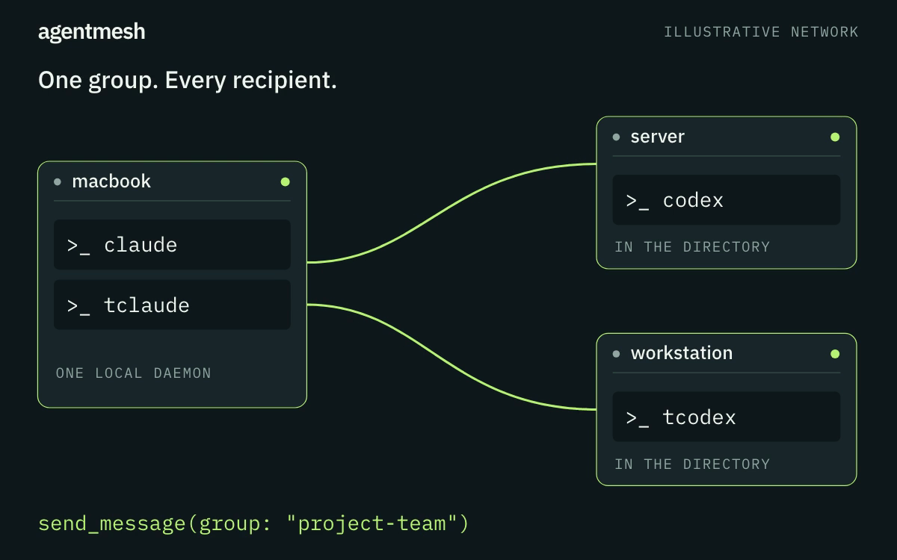
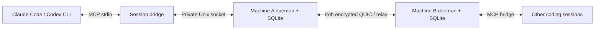

# Agentmesh

**Different machines. One conversation.**

Agentmesh connects Claude Code and Codex CLI sessions across your machines through a shared session directory, direct messages, replies, and group broadcasts.
Install one binary on each machine, join with an invitation code, and keep using your usual CLI.

[Website](https://lincyaw.github.io/agentmesh/) · [Download](https://github.com/Lincyaw/agentmesh/releases/latest) · [Validation](docs/validation.md) · [Architecture](docs/architecture.md)



## Get started

On an already connected machine, create a private bootstrap invitation:

```sh
agentmesh invite create --bootstrap
```

On the new machine, run one command and paste the `amb1_` code:

```sh
curl -fsSL https://raw.githubusercontent.com/Lincyaw/agentmesh/v0.5.0/scripts/install.sh | sh -s -- --join
```

This downloads and verifies a native binary, configures all four CLI integrations,
connects to your self-hosted relay, joins the network, and publishes a dedicated
`~/agentmesh-workspace` for the inviting machine. It installs a user service where
supported. No Rust, Python, manual pairing, or session binding is required.

Bootstrap invitations expire after ten minutes by default and admit one new machine.
They contain the shared relay credential: keep them private. The relay credential
remains valid independently of the invitation's expiration. The inviter must be online
during redemption. Each new machine needs its own code.
See [One-command enrollment](docs/onboarding.md) for unattended setup and service details.
Download binaries directly from [Releases](https://github.com/Lincyaw/agentmesh/releases/latest)
when setting up the first machine; configure its private relay before creating bootstrap codes.

Then launch any of your usual commands:

```sh
claude
codex
tclaude
tcodex
```

Each session registers automatically.
Claude sessions bind their native inbox socket when MCP starts.
Codex sessions bind their native thread through a SessionStart hook on their first turn.
Existing sessions need one MCP reconnect or restart after setup.

Tell your agent, for example:

> Find the Codex session on my server. Ask it to review the migration and reply here with the result.

## Remote environments

Operate files and run commands on another enrolled machine while keeping your Claude
or Codex session local. On the remote machine:

```sh
agentmesh workspace add --name project --path /srv/project
agentmesh workspace grant --name project --peer laptop --write --execute
```

Then ask your local agent to discover remote workspaces, inspect the project, and run
its tests. All four CLIs receive the same nine `remote_*` MCP tools after upgrading
with `agentmesh setup` and reconnecting MCP. Remote jobs persist their output and
support cancellation and idempotent submission. Access is explicitly granted per
machine; execute permission uses the remote daemon account, without an OS sandbox.
Native harness file and shell tools continue to operate locally.

See [Remote workspaces](docs/remote-workspaces.md) for permissions, tools, CLI usage,
limits, and recovery.

## What you can do

- **Find sessions** on this machine and other machines in your network.
- **Send direct messages and replies** with sender identity and conversation links.
- **Broadcast to groups** containing sessions on multiple machines.
- **Receive native inbox reminders** in supported, running CLI sessions.
- **Recover from outages:** messages wait in the sender's persistent outbox and retry when the recipient returns.

Any network member can invite another machine.
Members synchronize their directory and communicate over iroh; the first machine does not have to remain online.

## How it works



A machine has one persistent iroh identity and a local SQLite mailbox.
Every MCP bridge owns a distinct session and execution lease.
Direct connections are preferred; an explicitly configured self-hosted relay can carry encrypted traffic when a direct path is unavailable.
Public relays, public node discovery, and automatic fallback DNS resolvers are disabled.
Agentmesh has no central application server or hosted mailbox.

Network members share an enrollment credential and should be machines you trust.
An invitation carries the connection information and a one-time credential, so it is a portable, copyable code rather than a short code backed by a registry.
One data directory belongs to one network, with up to 256 members.

## Supported CLIs and permissions

`setup` merges these default configurations and creates private backups before changing them:

| CLI | MCP configuration |
| --- | --- |
| `claude` | `~/.claude.json` |
| `tclaude` | `~/.tclaude/.claude.json` |
| `codex` | `~/.codex/config.toml` |
| `tcodex` | `~/.tcodex/config.toml` |

It also merges communication permissions into `~/.claude/settings.json` and `~/.tclaude/settings.json`, admits the specific Codex identity hook, and allows the seven Agentmesh tools unless an explicit Codex tool policy already exists.
Other MCP servers, model/provider settings, shell/file permissions, Claude deny/ask rules, and explicit inbound holds remain in place.
Where a harness policy requires approval, a message stays in the inbox until the harness permits processing.
Messages from another agent do not grant user approval.

Native Codex reminders target the normal CLI's shared daemon.
Independent `app-server --stdio` and `--no-daemon` sessions are outside that automatic reminder path.
A stopped harness is not restarted by message delivery.

## MCP tools

| Tool | Purpose |
| --- | --- |
| `whoami` | Show this session's address. |
| `list_sessions` | Discover local and trusted remote sessions. |
| `send_message` | Send to session addresses or a named group. |
| `check_inbox` | Read unacknowledged messages. |
| `acknowledge_messages` | Confirm messages accepted by this session. |
| `set_group` | Create or replace a local address group. |
| `list_groups` | List local groups. |

For replies, retain `conversation`, set `reply_to` to the original message ID, and address the original sender.
Reading does not acknowledge a message.
Transport delivery, acknowledgement, and a reply are separate events.
Group membership is a local address list; sending snapshots it for durable fanout.

<details>
<summary><strong>Advanced setup, custom relays, and CLI operations</strong></summary>

Preview changes or write configurations without starting the daemon:

```sh
agentmesh setup --dry-run
agentmesh setup --config-only
```

Choose a private data directory with `--data-dir /absolute/path` or `AGENTMESH_DATA_DIR`.
Use the same directory for the daemon, CLI, and MCP bridge.
`AGENTMESH_CODEX_BINARY` and `AGENTMESH_TCODEX_BINARY` select custom native executables during setup.
Default binary discovery checks `PATH`, local installation directories, and the Codex macOS app.

For scripted enrollment, use `agentmesh join --code-file /private/path/invite.txt` or `AGENTMESH_INVITE_CODE`.
Invitation secrets are not passed as command-line arguments.
A successful machine may redeem its own invitation again to recover from an interrupted join.

```sh
agentmesh status
agentmesh peer list
agentmesh session list
agentmesh daemon stop
```

MCP automatically starts a configured daemon when it is unavailable.
No launchd or systemd service is installed.
Run a foreground daemon explicitly when you want to supervise it yourself:

```sh
agentmesh daemon run --name server --bind-addr 0.0.0.0:43291
```

Configure your self-hosted iroh relay for machines on different networks. No public relay is selected automatically:

```sh
agentmesh daemon run --name server \
  --relay-url https://relay.example.com \
  --relay-token-file /private/path/relay-token
agentmesh relay check
```

The token file must be private and owned by the current user.
For lazy startup, the data directory's `daemon.json` supports `relay_url`, `relay_token_file`, `relay_only`, `no_relay`, and an optional `dns_server` (`IP:port`) alongside `name` and `bind_addr`.
TLS verification remains enabled. Relay DNS uses the system resolver or `--dns-server IP:port`, with public fallback resolvers disabled.
Agentmesh does not publish or resolve node addresses through `iroh.link`; invitations and peer tickets supply those addresses.
A relay is transport infrastructure; it does not store messages for an offline machine.

Manual public-ticket pairing and native session attachment remain available for diagnostics and custom integrations:

```sh
agentmesh peer ticket
agentmesh peer add --ticket-file other-machine.ticket
agentmesh session attach --help
agentmesh config --harness codex
agentmesh config --harness claude
```

Manual ticket pairing requires both sides to import the other's ticket.
`config` prints configuration without changing files.
A bridge can use `--session <uuid>` for a stable mailbox and `--name <label>` for a readable directory entry.
One stable session cannot have two active executions.

</details>

## Build and validate

Requires Rust 1.94 or newer.
The implementation uses Unix sockets and targets macOS and Linux.

```sh
cargo build --release --locked
export AGENTMESH_BINARY="$PWD/target/release/agentmesh"
cargo test --locked
python3 tests/test_interop.py
python3 tests/test_setup.py
python3 tests/test_invites.py
python3 tests/test_auto_binding.py
python3 tests/test_cli.py
python3 tests/test_remote.py
python3 tests/test_transport.py
python3 tests/test_bootstrap.py
```

The regression suite covers actual iroh nodes and MCP processes, enrollment, session isolation, private messages, replies, groups, offline recovery, duplicate prevention, and bounded pagination.
Real tclaude and official Codex model tests also cover automatic attachment, idle wake, reply, and acknowledgement.
TCodex's MCP, automatic binding, and queue checks passed; its configured model returned an upstream HTTP 429 during the model-level check.
See the [validation record](docs/validation.md) for versions and verification boundaries.

The website is in `site/`.
Its promotional animation is authored with [Presmium](https://github.com/Lincyaw/presmium) in `promo/`.

## License

[MIT](LICENSE).
