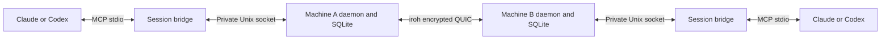

# Agentmesh architecture

Agentmesh is a single Rust executable for macOS and Linux.
Each machine runs one daemon with one persistent iroh identity and one local SQLite database.
Each Claude Code or Codex CLI session launches its own `agentmesh mcp serve` stdio subprocess.
The `tclaude` and `tcodex` wrappers use the same bridge and daemon.
The subprocess communicates with the daemon over an owner-only Unix socket.
The daemon authenticates remote machine identities using iroh and an explicit local peer allowlist.

## Installation and daemon lifecycle

`agentmesh setup` prepares all four configuration updates before writing any of them.
The default paths are `~/.claude.json`, `~/.codex/config.toml`, `~/.tclaude/.claude.json` and `~/.tcodex/config.toml`.
It preserves unrelated configuration and creates private backups before atomic replacement.
Every entry references one stable installed binary and one per-user data directory.
Each harness retains its own authentication and provider configuration.

Setup starts the daemon unless `--config-only` is set.
When a configured MCP bridge finds the daemon unavailable, it starts it from `daemon.json`.
The existing daemon lock resolves simultaneous starts; child processes are reaped while their MCP parent remains alive.
`daemon stop` is a local-only IPC operation and is unavailable over remote transport or MCP.
Setup restarts an older daemon under a private upgrade lock so concurrent bridges cannot stop a successor.
No launchd or systemd startup service is installed; the next MCP connection starts a stopped daemon.

## Identity and discovery

A machine persists its secret key across restarts.
A pairing ticket contains only its public identity, display name and connection addresses.
Manual pairing imports both public tickets.
The normal enrollment flow uses an expiring, single-use invitation containing the inviter ticket and a random 256-bit bearer secret.
The inviter stores only its digest and validates expiry from its own database.
Redemption atomically persists membership and binds the invitation to the authenticated joining endpoint, permitting retries only from that same endpoint.
The encrypted response supplies the network credential and public member tickets.
Members authenticate membership synchronization with that credential and update peer allowlists, without synchronizing harness credentials or message histories.
Any member can invite another machine; the first inviter is not a persistent coordinator.
A network is a mutually trusted fleet with at most 256 machines, and a data directory holds one network.
Manual peers do not automatically become network members.
An iroh identity proves which machine connected; it does not automatically authorize that machine.
Session addresses are `<endpoint-id>/<session-uuid>`.
Every MCP subprocess owns an execution lease; an active stable session cannot be claimed by a second process.
Remote directory queries fetch only the directly trusted peer's public session metadata.
Socket paths, harness credentials and wake tokens stay on the local machine.

## Message protocol

The custom ALPN is `agentmesh/messages/1`.
Bounded JSON requests use one bidirectional QUIC stream per operation.
Remote operations cover invitation redemption, authenticated network-member synchronization, session-directory queries and message delivery.
Remote callers cannot invoke arbitrary MCP tools or local administrative operations.
Workspace operations additionally require explicit per-peer grants on the executor.
An execute grant permits shell commands with that daemon account's permissions.
The receiver verifies that the message sender's machine matches the authenticated connection identity.
The message recipient must be an existing local session.

The sender transactionally persists the message and recipient deliveries before reporting acceptance.
The receiver persists each delivery before returning a transport receipt.
Messages are deduplicated by sender identity, message ID and recipient.
Retries after a lost receipt reuse the same immutable message.
Transport delivery, application acknowledgement and a reply are distinct concepts.
An offline recipient machine has no relay mailbox: messages remain in the sender's outbox and retry when both daemons are online.
The iroh transport uses explicit peer addresses and an optionally configured self-hosted relay.
The Minimal endpoint preset has no public node address lookup or publication.
No public relay is selected by default, and DNS fallback resolvers are disabled.
The system resolver (or an explicit private DNS server) resolves only required hostnames, such as the configured relay.
Every outgoing call filters peer addresses against the configured relay URL, even
when a persisted ticket, invitation or synchronized member advertises another relay.
Relay-only mode also filters direct addresses; a peer with no permitted address fails
before a network dial. Invalid relay-only or DNS profiles fail before daemon upgrade
can stop the previous version.
The application has no central server.
An optional custom relay can use a shared token supplied through a private, owner-controlled file.
The token stays on the local machine and is excluded from pairing tickets and error output.

## Remote workspaces and jobs

The executor uses a separate private `execution.sqlite` database for workspace roots,
per-machine grants, and durable job records; mailbox delivery never replays execution.
Only owner-side Unix IPC exposes workspace administration. An iroh peer is always
identified from its authenticated connection, and session MCP requests carry their
execution lease. Enrollment, membership gossip, and messages do not add grants.

Read/write tools resolve paths relative to directory descriptors with `O_NOFOLLOW`.
They reject parent traversal, special files and oversized or non-UTF-8 text.
File replacement checks the previous content hash and publishes by atomic rename;
create-only writes use no-replace publication. This serializes Agentmesh writers,
while independent local writers and shell jobs must coordinate their own edits.

Command admission persists `(caller machine, request ID, inputs)` before spawning.
The detached admission task completes even if its RPC caller disconnects.
Repeated inputs return the same job, while conflicting reuse fails.
Each job has a process group, a timeout, separate bounded output files and byte cursors.
Pipe drains run concurrently. After a process ends or is killed, inherited pipes have
a bounded drain grace period, then are closed with explicit incomplete-output flags.
Output chunks retain incomplete UTF-8 suffixes for the next read.
Daemon restart marks unfinished jobs interrupted and never respawns them.

Execute permission grants account-level access, rather than a directory sandbox.
Revocation cancels that machine's active jobs and rejects future workspace requests.
Jobs are shared by sessions on their originating machine and hidden from other machines.
The nine remote MCP tools retain normal harness approvals; setup still auto-grants
only the seven communication tools. See [Remote workspaces](remote-workspaces.md).

## Groups

A group is an explicitly managed local address list.
Sending to a group snapshots its members and persists one delivery per recipient in the same local transaction.
Members can span trusted machines and local sessions.
Every message carries a conversation ID, optional reply ID and original sender address.
The first version provides reliable group fanout rather than replicated membership or total ordering across writers.

## Harness adapters

The MCP tools provide session listing, message sending, inbox reading, acknowledgement and group management.
The bridge registers at startup, renews its lease and retires at shutdown.
Claude Code exposes its native inbox socket to the MCP subprocess; manual attachment remains available for custom harness setups.
Codex binds a specific thread ID and queues a static inbox reminder through its own CLI.
Wake reminders contain message IDs, never a remote instruction disguised as a local user request.
The model retrieves the attributed message body through MCP.
Claude bridges automatically read their own native session ID, socket and token from the harness-provided environment.
Codex SessionStart hooks call the owning bridge's whoami tool with native threadId request metadata.
The bridge binds once and fences every subsequent tool call to that thread.
Setup admits only that specific normalized identity hook, and grants automatic use to the seven mailbox tools.
Existing explicit tool approval policies, Claude inbound holds, and organization restrictions remain effective.
Native Codex hooks start on the first turn, and queue delivery targets the normal shared daemon using the matching binary and home directory.
Generic harnesses can use the MCP inbox without native wake.
Uncertain native wake submissions are recorded and not automatically repeated.
Peer messages never grant permission to run shell commands or change files.
Setup changes only the documented communication-tool permissions, inbound defaults and the dedicated identity hook.

## Acceptance

1. Build one executable and expose noninteractive JSON CLI operations.
2. Run two daemons with independent data directories and identities.
3. Reject unpaired peers and forged sender identities.
4. Discover multiple sessions and exchange direct messages and replies over iroh.
5. Fan out a group message to sessions on both machines.
6. Restart a recipient daemon and deliver the sender's persisted outbox without duplicates.
7. Drive MCP initialize, tools/list and tools/call over stdio for independent sessions.
8. Verify native adapter payloads and record actual Claude Code and Codex CLI checks separately.
9. Preserve identity and mailbox state across process restarts.
